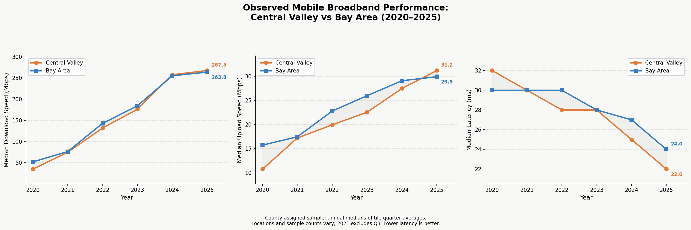
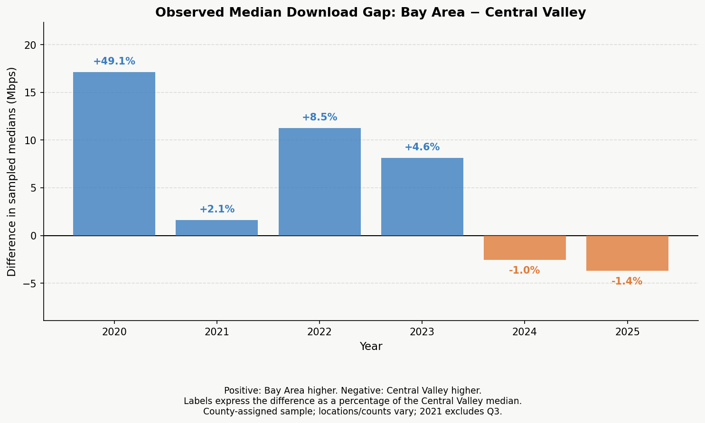
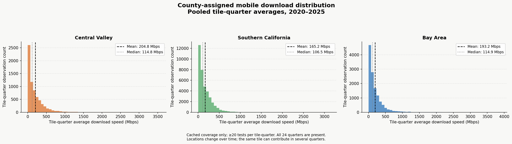
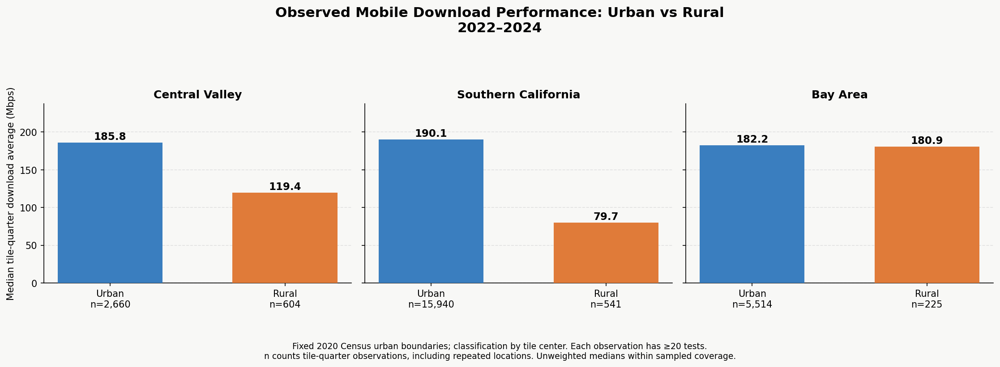
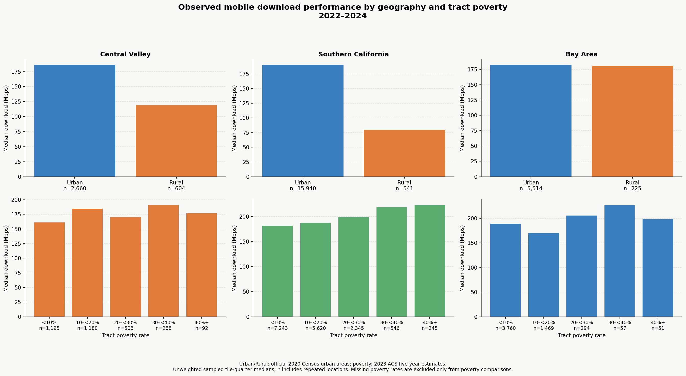
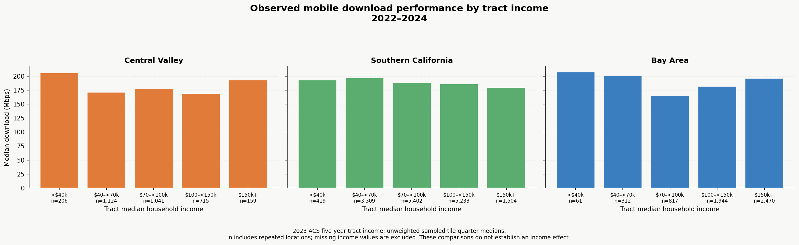

# Ookla Mobile Broadband Equity Analysis

### A CO³ Labs Study | Christian Olivares-Rodriguez

This project examines observed mobile broadband performance across the Central Valley, Bay Area, and Southern California using Ookla Open Data from 2020–2025. It compares download speed, upload speed, and latency, then joins the observed locations to Census demographics and official urban-area boundaries.

The results describe the sampled tile-quarter records. They are not estimates of service for every resident, a measure of household affordability, or evidence that income or geography causes a speed difference.

## Latest Results

The notebook was run from a fresh kernel on **November 13, 2026**. Its numerical results are also saved in [`reports/analysis_summary.json`](reports/analysis_summary.json).

### Regional Download Comparison

| Year | Central Valley (Mbps) | Bay Area (Mbps) | Southern California (Mbps) |
|---|---:|---:|---:|
| 2020 | 34.92 | 52.06 | 43.94 |
| 2021 | 76.57 | 78.57 | 75.66 |
| 2022 | 131.70 | 142.95 | 156.90 |
| 2023 | 176.21 | 184.33 | 196.26 |
| 2024 | 257.68 | 255.14 | 249.43 |
| 2025 | 267.47 | 263.76 | 276.49 |

The Bay Area sampled median was **49.1% higher** than the Central Valley median in 2020. The Central Valley sampled median exceeded the Bay Area median in **2024 and 2025**. In 2025, the medians were **267.47 Mbps** and **263.76 Mbps**, respectively. This change in the sampled ranking does not establish equivalent service across the two regions; the observed locations and annual sample sizes change.

### Urban and Rural Samples

The following comparison uses 2022–2024 observations and fixed 2020 Census urban-area boundaries. Each reported speed is the unweighted median of the observed tile-quarter download averages.

| Region | Classification | Median download (Mbps) | Tile-quarter observations | Distinct tiles |
|---|---|---:|---:|---:|
| Central Valley | Urban | 185.80 | 2,660 | 1,513 |
| Central Valley | Rural | 119.38 | 604 | 440 |
| Southern California | Urban | 190.10 | 15,940 | 6,763 |
| Southern California | Rural | 79.73 | 541 | 357 |
| Bay Area | Urban | 182.16 | 5,514 | 2,417 |
| Bay Area | Rural | 180.88 | 225 | 168 |

Rural sampled medians were lower than urban medians in the Central Valley and Southern California. The Bay Area medians were close, but its rural comparison rests on **225 observations from 168 distinct tiles**. That small sample cannot establish equal service across the Bay Area's urban and rural communities.

Observation counts include repeated measurements of the same location; distinct-tile counts show the geographic sample size. Locations without a qualifying observation are not evidence of missing service.

### Income and Poverty Comparisons

Median speeds do not rise consistently with tract income across all three regions, and the highest-poverty bracket is not uniformly the slowest. For example, the Bay Area's below-$40,000 income bracket has a median of **206.75 Mbps**, but contains only **61 observations from 9 distinct tiles**. Small brackets should not be treated as broad evidence about the populations living in those tracts.

The notebook reports counts alongside bracket medians. Its exploratory regressions use standard errors clustered by tile to account for repeated observations at a location. These models describe associations within the sample; they do not establish causation or rank a “dominant predictor.”

## Data and Methods

| Source | Use |
|---|---|
| [Ookla Open Data](https://github.com/teamookla/ookla-open-data) | Quarterly mobile performance tiles, 2020–2025, retrieved from AWS S3 |
| [2023 ACS five-year estimates](https://www.census.gov/data/developers/data-sets/acs-5year.html) | Tract median household income and poverty counts |
| [2023 Census TIGER/Line tract boundaries](https://www2.census.gov/geo/tiger/TIGER2023/TRACT/) | Assign observed tile centers to California counties and Census tracts |
| [2020 Census urban areas distributed in TIGER/Line 2023](https://www2.census.gov/geo/tiger/TIGER2023/UAC/) | Classify tile centers as Urban or Rural |

- The three cached regional extracts contain **1,330,789** records before pooling and removing overlap. The extraction rectangles do not cover every part of every named county. County assignments make the regional groups mutually exclusive within the cached coverage.
- All three extracts contain all **24 quarters from 2020 through 2025**, including the recovered 2021 Q3 records. Different annual sample sizes do not imply a partial year.
- Records must have **at least 20 speed tests per tile-quarter**. This threshold limits very sparse records; it does not make the sample representative of a population.
- Overlapping extracts are pooled and deduplicated using `quadkey`, `year`, and `quarter`. The county-assigned study sample contains **56,972** qualifying records.
- Speeds are converted from kbps to Mbps. Regional comparisons use unweighted medians of tile-quarter averages. Records are not individual speed tests, unique devices, or people.
- The demographic and urban/rural comparisons use **2022–2024** observations alongside the **2023 ACS five-year release**. This reduces, but does not eliminate, differences in the time periods represented.
- A tile center is **Urban** when it intersects an official 2020 Census urban-area polygon and **Rural** otherwise. Tract land area is not used as a density proxy, and there is no Suburban category.
- Poverty rate is `B17001_002E / B17001_001E × 100`: people below poverty divided by the population for whom poverty status is determined. A zero denominator produces a missing rate, not zero poverty.
- Locations and sample composition vary over time. Repeated tiles and neighboring locations can be related. Comparisons and exploratory models should be read with these limits in mind.

## Tools and Regional Definitions

The analysis primarily uses pandas for preparation and aggregation, GeoPandas for spatial joins, Matplotlib for charts, and Folium for interactive maps. NumPy, PyArrow, the Census client, and statsmodels support numerical work, Parquet data, demographics, and exploratory regression. Exact versions are listed in `requirements.txt` and the analysis report.

County assignments are mutually exclusive:
- **Bay Area:** Alameda, Contra Costa, Marin, Napa, San Francisco, San Mateo, Santa Clara, Solano, Sonoma.
- **Central Valley:** Shasta, Tehama, Glenn, Butte, Colusa, Sutter, Yuba, Yolo, Sacramento, San Joaquin, Stanislaus, Merced, Madera, Fresno, Kings, Tulare, Kern.
- **Southern California:** Imperial, Los Angeles, Orange, Riverside, San Bernardino, San Diego, Santa Barbara, Ventura.

These definitions assign observations to regions; they do not imply complete geographic coverage of the named counties. The corrected county-assigned sample is also used for the demographic joins, charts, and exploratory models.

## Charts and Maps

### Annual Download, Upload, and Latency



### Download Gap Between the Bay Area and Central Valley



### Download Distribution by Region



### Urban and Rural Download Performance



### Urban and Rural Comparison and Poverty Brackets



### Income Brackets



The notebook displays regional Folium maps with markers for the fastest and slowest observed tile-quarter records. It also saves [`central_valley_county_map.html`](central_valley_county_map.html), which can be opened locally in a browser. These markers do not establish persistent best or worst service at a location.

## How to Run

Use Python 3.13 and run from the repository root.

```bash
git clone https://github.com/Oli-Data/Ookla-Data.git
cd Ookla-Data
python3.13 -m venv .venv
source .venv/bin/activate
python -m pip install -r requirements.txt
```

Create a local `.env` file containing your [Census API key](https://api.census.gov/data/key_signup.html):

```text
CENSUS_API_KEY=your_key_here
```

For a repeatable run from a fresh kernel:

```bash
python scripts/run_analysis.py
```

The runner executes every cell in order and saves the executed notebook after a successful run. It also refreshes the charts, saved map, and numerical summary. Alternatively, open `ookla_data_project.ipynb` in Jupyter or VS Code, select the environment with the installed dependencies, restart the kernel, and run all cells.

`REBUILD_FROM_AWS = False` loads the existing regional Parquet files and checks period coverage, coordinates, and duplicate keys. Set it to `True` only when intentionally downloading and rebuilding the regional extracts; that path overwrites the regional Parquet files and requires substantially more time and memory.

The first run may download Census data and boundaries. Reusable downloads are stored under `.ookla-cache/`. Keep `.env`, caches, backups, and the local environment out of version control. See [`ookla_etl.py`](ookla_etl.py) for coordinate normalization and the targeted 2021 Q3 recovery logic.

---
Analysis by Christian Olivares-Rodriguez | CO³ Labs
